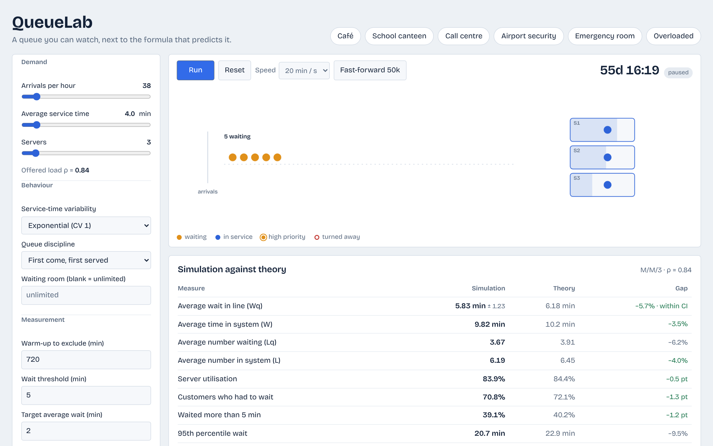
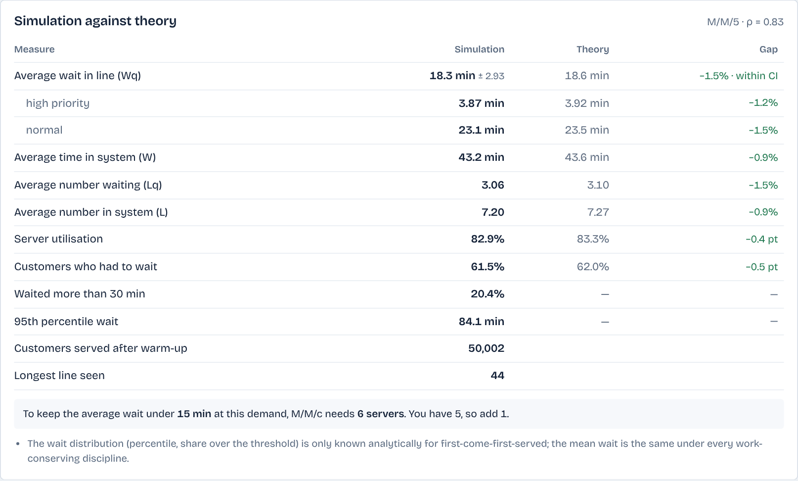
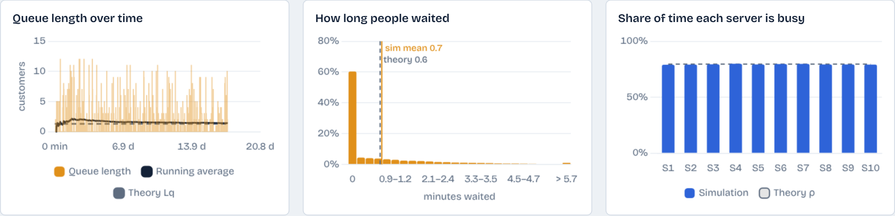

# QueueLab

A queue you can watch, next to the formula that predicts it.

QueueLab is a browser-based discrete-event simulator for multi-server queues. You set how many customers arrive per hour, how long service takes and how many servers there are, then watch the line form. Next to the animation, the Erlang C formula (and its relatives for finite rooms, priority classes and non-exponential service) predicts what the long-run averages should be. The table in the middle shows the two side by side, with a confidence interval on the simulated wait so you can tell noise from disagreement.

Live version: https://berkaydiin.github.io/queuelab/

## What you can do with it

- Drag three sliders (arrivals per hour, average service time, servers) and see the queue respond in real time. The offered load ρ updates as you drag, and the page tells you when you've crossed 1.
- Pick a service-time distribution: deterministic, Erlang-2, Erlang-4, exponential or hyperexponential. The variability of service, not just its mean, changes the wait, and the M/G/c approximation shows by how much.
- Give the queue a finite waiting room. Customers who find it full are turned away; the M/M/c/K model predicts what share.
- Switch to two priority classes (non-preemptive). High-priority customers skip the line. Cobham's formula predicts each class's wait, and the simulation checks it.
- Change the discipline to last-come-first-served to see that the mean wait doesn't move but the distribution does (the percentile and threshold rows lose their theory column, since those are only known for first-come-first-served).
- Fast-forward 50,000 customers at a time when you want numbers rather than animation.
- Read a staffing answer: "to keep the average wait under 2 minutes you need 4 servers".
- Download the per-customer log as CSV (arrival, service start, departure, wait, server) for everyone served after the warm-up, or copy a link that reproduces your exact settings and random seed.

Six presets give realistic starting points: a café, a school canteen, a call centre with a 12-call hold limit, airport security with near-constant screening times, an emergency room with triage priorities, and a deliberately overloaded counter.

## The theory in the right-hand column

Arrivals are Poisson with rate λ per minute. Each of c servers takes on average 1/μ minutes per customer. The offered load is

    ρ = λ / (c·μ)

and the long-run averages only exist when ρ < 1.

**M/M/c.** With exponential service, the probability that an arriving customer has to wait is the Erlang C formula

    C(c, a) = [ (aᶜ/c!) / (1−ρ) ] / [ Σₙ₌₀ᶜ⁻¹ aⁿ/n! + (aᶜ/c!) / (1−ρ) ],   a = λ/μ

The mean queue length follows as Lq = C·ρ/(1−ρ), and Little's law gives the mean wait Wq = Lq/λ. The wait beyond zero is exponential, so P(Wq > t) = C·e^(−(cμ−λ)t), which is where the "waited more than X minutes" row and the 95th percentile come from.

**M/M/c/K.** With K total places (servers plus waiting spots), state probabilities are computed directly and normalised; the probability of state K is the share of customers turned away.

**M/G/c.** For non-exponential service there is no exact multi-server formula. QueueLab uses the Allen-Cunneen approximation, which scales the M/M/c queue wait by (1 + CV²)/2, where CV is the coefficient of variation of service time. For a single server this is exact (it reduces to Pollaczek-Khinchine); for several servers it is an approximation, and the page says so.

**Priority.** For two non-preemptive classes with the same service distribution, Cobham's formula gives Wq for class k as W₀ / ((1−σₖ₋₁)(1−σₖ)), with W₀ = C/(cμ) and σₖ the cumulative load of classes up to k.

**Warm-up.** A queue that starts empty needs time before its averages mean anything. The page estimates that settling time as 1/(cμ(1−√ρ)²) and warns when the warm-up you've set is shorter than twice that.

## How the simulation works

`js/sim.js` is a plain event-driven simulator with no DOM dependency. The state is the clock, the queue(s) and an array of servers; the next event is whichever comes first, the next arrival or the earliest service completion. Arrivals draw an exponential inter-arrival time; service draws from the chosen distribution. Idle servers are assigned by longest-idle routing, the way most call-centre systems do it.

Statistics are only collected after the warm-up period, including each server's busy time. Time-weighted averages (Lq, L, utilisation) integrate the state between events; customer averages (Wq, W, percentiles) come from the full list of recorded waits. The 95% confidence interval on Wq uses the method of batch means with ten batches, which copes with the autocorrelation of consecutive waits better than treating them as independent would.

The random number generator is seeded (mulberry32), so a given link reproduces the same run on any machine.

## Checking that it's right

`npm test` runs `tests/run.js`, which checks the analytical module against textbook values (M/M/1 with ρ = 0.8 gives Lq = 3.2; the M/M/1/K finite-queue formula; priority conservation; Pollaczek-Khinchine for M/D/1) and then runs the simulator for 400,000 customers per scenario and compares it to the formulas:

| Scenario | Quantity | Simulation | Theory |
| --- | --- | --- | --- |
| M/M/3, ρ = 0.80 | Wq | 3.30 ± 0.08 | 3.24 |
| M/M/3, ρ = 0.80 | P(wait) | 0.648 | 0.647 |
| M/M/1/5 | share turned away | 0.1659 | 0.1667 |
| M/D/1, ρ = 0.80 | Wq | 1.999 | 2.000 |
| M/E₄/1, ρ = 0.80 | Wq | 2.45 | 2.50 |
| Priority M/M/3 | Wq high / low | 0.84 / 4.31 | 0.85 / 4.26 |
| LIFO M/M/3 | Wq (mean unchanged) | 3.32 ± 0.15 | 3.24 |

Times in minutes. All 26 checks pass in about three seconds.

## Running it locally

The app is static files, but `js/app.js` is an ES module, so it needs to be served over HTTP rather than opened as a file:

    git clone https://github.com/berkaydiin/queuelab.git
    cd queuelab
    python3 -m http.server 8080
    # then open http://localhost:8080

Node 18 or later is enough to run the tests (`node tests/run.js`). There is no build step and no dependency to install: Chart.js is vendored in `js/vendor/`, and the Bricolage Grotesque font is self-hosted in `css/fonts/`.

## Project layout

    index.html          page structure and the explainer text
    css/style.css       layout, light and dark themes
    css/fonts.css       self-hosted font faces
    js/rng.js           seeded PRNG and the service-time distributions
    js/sim.js           discrete-event engine, statistics, CSV export
    js/theory.js        Erlang C, M/M/c/K, Allen-Cunneen, Cobham, staffing
    js/canvas.js        the animation
    js/charts.js        the three Chart.js charts
    js/app.js           wiring: form, presets, URL state, results table
    tests/run.js        analytical and simulation checks

## Limits worth knowing

- Arrivals are always Poisson. Time-varying arrival rates (a lunch rush) aren't modelled.
- Priority is non-preemptive with two classes and identical service for both.
- The M/G/c column is an approximation for c > 1 and is labelled as such; there is no theory column for a finite room with non-exponential service, so the exponential-service figures are shown for reference.
- Customers never leave the line once they've joined (no reneging).

## Background

Built for MLH Global Hack Week: Builders (6 to 12 November 2026) by Mustafa Berk Aydın, a high-school student in Istanbul who wants to study industrial engineering. The formulas follow Gross and Harris, *Fundamentals of Queueing Theory*.

MIT licence. Chart.js is MIT; the font is under the SIL Open Font License (see `css/fonts/OFL.txt`).
